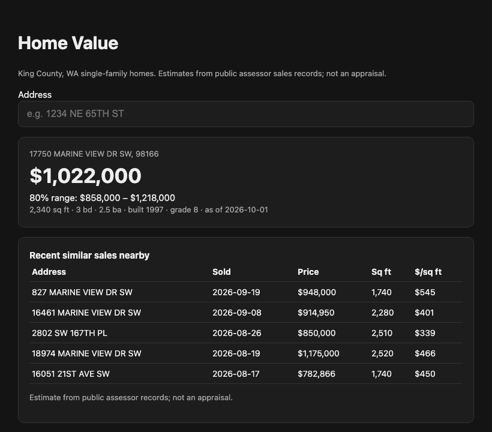
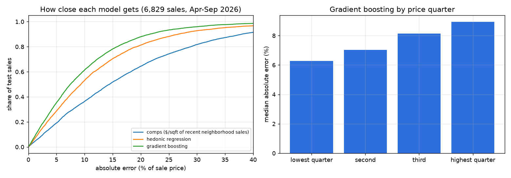

# homevalue — Home Value Estimates for King County, WA

An automated valuation model, a small Zestimate, built on **114,839 real arm's-length home sales** from the King
County Assessor (2019 – September 2026). It covers:
- **Cleaning:** separating market sales from foreclosures, gifts, divorces and family transfers.
- **Models:** a comparable-sales baseline, a hedonic regression and gradient boosting.
- **Evaluation:** the error metrics Zillow publishes for its own estimates, on sales after everything the model saw.
- **Price ranges:** calibrated to contain the sale price a stated share of the time.
- **A web app:** look up any of 451,612 single-family homes and get an estimate, a range and the comparable sales
  behind it.



## Results

Trained on sales through September 2025, price ranges calibrated on October 2025 – March 2026, **tested on 6,829
sales from April – September 2026** (`results/eval.json`):

| Model | Median error | Within 5% | Within 10% | Within 20% |
|---|---|---|---|---|
| Comps: $/sq ft of the last 15 neighborhood sales × size | 14.4% | 19.1% | 36.4% | 64.4% |
| Hedonic (log-linear) regression | 9.4% | 28.7% | 53.1% | 81.3% |
| **Gradient boosting** | **7.5%** | **35.4%** | **61.4%** | **87.9%** |

Gradient boosting's median error is 1.6–2.1 points lower than the regression's (95% bootstrap interval).
Error grows with price: 6.3% for the cheapest quarter of homes and 8.9% for the most expensive, where houses are
more individual and comparable sales are fewer.



**Price ranges.** An 80% range should contain the sale price 80% of the time:

| | Overall | Cheapest quarter | 2nd | 3rd | Most expensive quarter | Typical half-width |
|---|---|---|---|---|---|---|
| One width for every home | 76.5% | 81.5% | 79.9% | 75.2% | **69.3%** | ±14% |
| Width per predicted-price band | 76.5% | 74.5% | 77.4% | 79.5% | **74.8%** | ±16% |

- **One width for every home** was too narrow for expensive homes: it caught only 69% of their prices.
- **A width per predicted-price band** (Mondrian conformal; predicted price is known when estimating) evens
  coverage across price levels. The app uses it.
- **Both still come up about 3.5 points short overall.** The ranges were calibrated on winter sales and tested on
  spring and summer, when prices move more. Calibrating on a rolling window that includes the same season a year
  earlier is the next thing to try.

## How it works

- **Which sales count** (`data.py`). A sale is kept if:
  - it is residential, an existing single-family house, and recorded with a warranty or statutory warranty deed;
  - its sale reason is "none" (no foreclosure, divorce, gift or estate) and it has no warning flags;
  - it is one parcel per transaction, over $50,000, and not a re-sale within 90 days;
  - its price per square foot is within the 0.2–99.8 percentile range.
  
  One bug here would have quietly ruined everything: the county switched most deeds from code 3 to code 2 in 2020.
  Filtering on code 3 alone kept 16,800 sales in 2019 but only a few hundred to a thousand a year from 2021 on, 90%
  of later sales gone without an error. A check of sales per year caught it.
- **Features with no look-ahead** (`model.py`): every feature uses only what was known on the sale date.
  - **Market level:** countywide log $/sq ft over the previous three months.
  - **Neighborhood comps:** median log $/sq ft of the previous 15 sales in the same assessor neighborhood, falling
    back to the ZIP code.
  - **The house:** size, lot, construction grade, condition, baths, bedrooms, age, views, waterfront and traffic
    noise.
  
  A test changes later prices and checks that earlier features don't move.
- **Models:** log price with scikit-learn: ridge regression with ZIP indicators, and histogram gradient boosting
  with early stopping.
- **Ranges:** split conformal on the calibration period, globally and per predicted-price band.
- **App** (`app.py`): FastAPI with a dependency-free page. You search an address, then see the estimate, an 80%
  range and up to five similar sales from the last year in the same neighborhood. The served model is refit with
  the same recipe one period later: trained through March 2026, ranges calibrated on April – September 2026.

## Run it

```bash
uv sync
uv run python -m homevalue.evaluate        # downloads the assessor extracts (~200 MB), cleans, evaluates, saves the model
uv run uvicorn homevalue.app:app           # http://127.0.0.1:8000
uv run pytest                              # cleaning rules, no look-ahead, range calibration, API (synthetic data)
```

## Limitations

- **Building records are current, not as of the sale,** so a house remodeled after selling looks remodeled when it
  sold.
- **No listing data:** no photos, descriptions, days on market or list prices, which drive much of a real
  estimator's accuracy on homes for sale.
- **Locations are assessor neighborhoods and ZIP codes,** not exact coordinates.
- **Single-family only;** condos and townhomes are filed separately by the county.
- **Not an appraisal.**

## License and data

Code under MIT (see `LICENSE`). Data are public King County Assessor extracts, downloaded at run time and not
stored here. Built with help from Claude (Anthropic) via Claude Code; I reviewed, tested and verified the code and
results.
